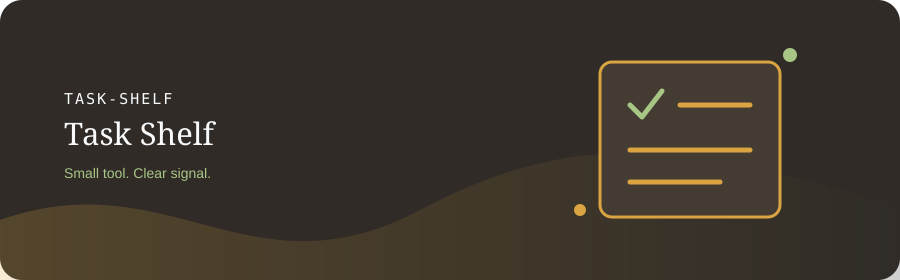

<div align="center">



# Task Shelf

**A no-account, no-server task manager for the terminal.**

[](https://www.python.org/) [](LICENSE)

</div>

## Why it exists

Keep a small task list in a local JSON file you own. Stores task text and completion state in a JSON file (default: ~/.taskshelf.json). It is intentionally single-user and single-process; it does not sync devices or coordinate concurrent writers.

## Features

- Add, list and complete tasks
- Stable integer IDs
- Atomic file replacement to reduce partial writes
- Custom storage path for projects or tests

## Quick start

Python 3.10+; no third-party packages.

```bash
git clone https://github.com/MofidChallenge10/task-shelf.git
cd task-shelf
python tool.py --help
```

### Example

```bash
python tool.py add "Review the release notes"\npython tool.py list\npython tool.py done 1
```

## Self-test

```bash
python tool.py --self-test
```

The self-test uses the standard-library `unittest` module. Network-based tools do not contact external services during self-test.

## Scope and safety

Stores task text and completion state in a JSON file (default: ~/.taskshelf.json). It is intentionally single-user and single-process; it does not sync devices or coordinate concurrent writers. Review output before using it in production workflows.

## Design notes

The illustration is an original lightweight SVG. Motion is decorative and stops when `prefers-reduced-motion` is enabled; CLI output remains plain and pipe-friendly.

## Contributing

Issues and pull requests are welcome. Keep dependencies minimal, add focused tests for behavior changes, and update examples when options change.

## License

MIT — see [LICENSE](LICENSE).
